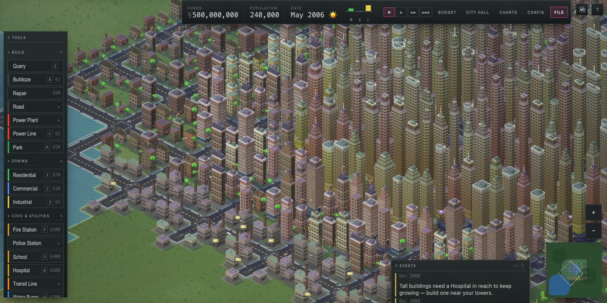

# SimCity Web

A browser city-building game inspired by **SimCity 4**, built with TypeScript
and Canvas 2D. No frameworks, no art assets — every building is drawn
procedurally.



## The defining feature

Like SimCity 4, this is a city *simulation*, not a city painter. You never
place buildings. You zone land, lay roads, and provide power; the simulation
decides what happens next:

- **RCI demand** — residents chase jobs, commerce chases customers, industry
  chases an external market. The demand bars in the HUD show what the city
  wants.
- **Desirability** — each tile weighs land value, pollution, and commute time.
  Nice tiles grow tall; tiles beside the coal plant stay shacks.
- **Decay and gentrification** — cut the power or tank the economy and
  buildings abandon (boarded-up grey shells). Fix the problem and they
  redevelop on their own.
- **A living city** — zone at low, medium, or high density and watch shacks
  become towers as land value, services, and schools allow; cars roam the
  busy roads and citizens stroll outside their buildings.

## Run it

```sh
npm install
npm run dev      # open the printed localhost URL
```

`npm test` runs the simulation's unit suite; `npm run build` makes a
production bundle.

## How to play

New maps come with lakes and forests. Before you build anything, the
**terrain tools** (Water / Forest / Level Land) are free — sculpt the
geography to taste; once the city is founded they cost money. Nothing can
be built on water or forest, but living near them raises land value.

Start with a **coal plant**, draw a **road**, then zone **residential /
commercial / industrial** beside the road (within 2 tiles). Buildings need
both road access and power to develop.

Power conducts through adjacent zones and buildings but **not across roads or
empty land** — string power lines to bridge gaps (lines can be placed on road
tiles to cross them). Unpowered zones show a yellow ⚡ bolt; hook them up with
a line from the plant or by zoning a connected path. The Power data view shows
what's connected.

Keep industry (and the coal plant) away from homes: pollution wrecks
residential land value. Parks raise it.

Growing past small buildings takes **civic services**: fire coverage unlocks
stage 2, police + school coverage unlock stage 3 (industry skips the school
requirement). Stations need power, cover a radius (see the coverage data
views), and charge monthly upkeep. Buildings with **no fire coverage can burn
down** — you'll get a notice when one does.

Watch the budget — roads, plants, and services cost upkeep monthly; taxes
above 9% suppress demand.

| Control | Action |
| --- | --- |
| Left click / drag | apply tool (zones, parks, bulldoze drag out a rectangle; roads paint) |
| Minimap click | jump the camera |
| Charts button | population and funds history |
| Query tool | inspect any tile |
| Middle-drag or Space+drag | pan (arrow keys work too) |
| Q / E (hold) | rotate the view — full 360° |
| Mouse wheel | zoom |
| Esc | deselect tool |
| ⏸ ▶ ▶▶ ▶▶▶ | pause / normal / fast / cheetah |

Save/Load keeps one city in your browser's localStorage.

## Design docs

- Spec: `docs/superpowers/specs/2026-07-18-simcity-web-design.md`
- Plan: `docs/superpowers/plans/2026-07-18-simcity-v1.md`

The spec's roadmap lists what's next: civic services, density levels, terrain
and water, congestion-aware traffic, and eventually SC4's region play.
